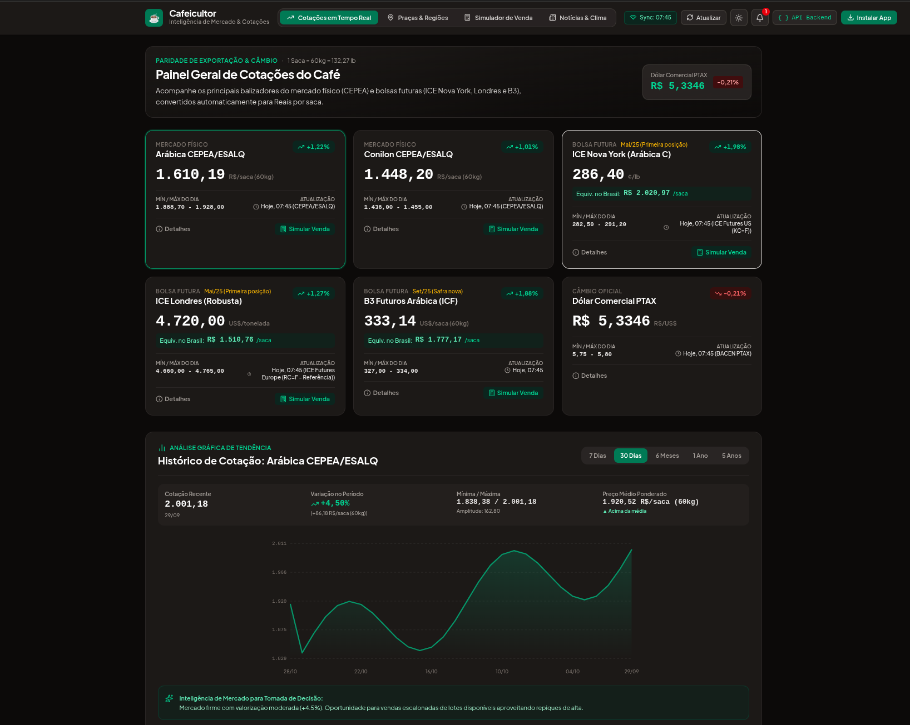
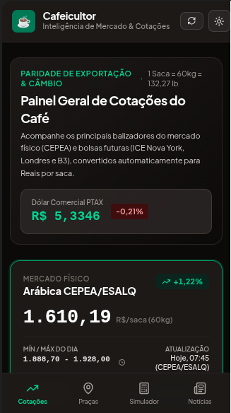

# ☕ Cafeicultor - Inteligência de Comercialização & Cotações do Café

> **Plataforma Agrotech Full-Stack & Mobile-First** voltada para produtores de café no Brasil, integrando cotações em tempo real do mercado físico e futuro, cálculo automatizado de paridade de exportação, simulador de preço líquido na fazenda e operação offline no cafezal.

[](https://www.typescriptlang.org/)
[](https://react.dev/)
[](https://expressjs.com/)
[](https://tailwindcss.com/)
[](https://web.dev/progressive-web-apps/)
[](LICENSE)

---

## 📱 Demonstração Visual do Layout (Web Desktop & Mobile PWA)

<div align="center">
  <table>
    <tr>
      <td width="65%" align="center" valign="top">
        <strong>🖥️ Painel Web Desktop (Visão Geral, Bolsas & Paridades de Exportação)</strong>
        <br /><br />
        
        <br /><br />
        <em>Dashboard completo: cotações em tempo real (CEPEA Arábica/Conilon, ICE NY, ICE Londres, B3 ICF, Dólar PTAX), conversão automática de paridade em R$/saca, console da API Backend e análise gráfica interativa.</em>
      </td>
      <td width="35%" align="center" valign="top">
        <strong>📱 Aplicativo Mobile no Campo (PWA)</strong>
        <br /><br />
        
        <br /><br />
        <em>Navegação ergonômica pelo polegar com barra de 4 abas, botão de alto contraste (Modo Sol Forte) e operação offline no cafezal.</em>
      </td>
    </tr>
  </table>
</div>

---

## 📌 Sumário
1. [Visão Geral & Proposta de Valor](#-visão-geral--proposta-de-valor)
2. [Funcionalidades Principais (MVP)](#-funcionalidades-principais-mvp)
3. [Fórmulas Matemáticas & Regras de Negócio](#-fórmulas-matemáticas--regras-de-negócio)
4. [Arquitetura do Backend & API REST](#-arquitetura-do-backend--api-rest)
5. [Contrato da API (`/api/market/coffee-consolidated`)](#-contrato-da-api-apimarketcoffee-consolidated)
6. [Resiliência & Modo Campo (Offline)](#-resiliência--modo-campo-offline)
7. [Estrutura de Pastas do Projeto](#-estrutura-de-pastas-do-projeto)
8. [Como Executar o Projeto Localmente](#-como-executar-o-projeto-localmente)
9. [Roadmap Evolutivo (Fases 2 e 3)](#-roadmap-evolutivo-fases-2-e-3)
10. [Licença](#-licença)

---

## 🌾 Visão Geral & Proposta de Valor

A comercialização do café é um dos momentos mais críticos da safra. Historicamente, o produtor rural enfrenta:
* **Assimetria de Informações:** Cotações internacionais em unidades complexas (centavos de dólar por libra-peso ou dólares por tonelada) que não refletem intuitivamente a realidade da saca de 60kg em Reais.
* **Custos Ocultos e Deduções:** Dificuldade em estimar o preço líquido efetivamente recebido na porteira após frete, corretagem, Funrural, catação e ágio/deságio de bebida.
* **Baixa Conectividade:** Falta recorrente de sinal de internet 3G/4G no meio dos talhões da lavoura.

O **Cafeicultor** resolve essas dores centralizando os indicadores do **CEPEA/ESALQ, B3 (ICF), ICE Nova York (KC=F), ICE Londres (RC=F) e Dólar Comercial PTAX (BACEN)** com conversão automática, simulação de venda e funcionamento em cache offline.

---

## 🚀 Funcionalidades Principais (MVP)

### 1. Painel de Cotações em Tempo Real (RF-MVP-01)
* **Mercado Físico (CEPEA/ESALQ):** Café Arábica Tipo 6 Bebida Dura e Conilon Tipo 7 em R$/saca (60kg).
* **Bolsa Internacional ICE NY (Arábica):** Cotação em `¢/lb` com conversão automática instantânea para `R$/saca`.
* **Bolsa Internacional ICE Londres (Robusta):** Cotação em `USD/Ton` com conversão instantânea para `R$/saca`.
* **B3 Futuros (Brasil):** Contrato ICF em US$/saca e convertido em R$/saca.
* **Câmbio Oficial:** Dólar Comercial PTAX diário do Banco Central do Brasil.
* **Status de Mercado:** Indicadores de abertura/fechamento das bolsas, horários de atualização e sincronização sob demanda.

### 2. Filtro Regionalizado de Praças de Mercado (RF-MVP-02)
* Mapeamento detalhado dos principais polos produtores:
  * **Minas Gerais:** Sul de Minas, Cerrado Mineiro (D.O.), Matas de Minas;
  * **Espírito Santo:** Norte Capixaba (Conilon) e Região Serrana (Arábica de Altitude);
  * **São Paulo:** Alta Mogiana;
  * **Bahia:** Planalto da Bahia e Chapada Diamantina;
  * **Rondônia:** Robustas Amazônicos;
  * **Paraná:** Norte Pioneiro.
* Filtros por estado, grupo botânico (Arábica vs. Conilon) e qualidade de bebida (*Dura, Mole/CD, Rio/Riopardense, Conilon Padrão*).
* Exibição de preço médio, faixas de mínima e máxima, liquidez e envio direto para o simulador.

### 3. Calculadora de Conversão & Preço Líquido na Fazenda (RF-MVP-03)
* **Simulador Interativo da Venda:** O cafeicultor insere o volume de sacas (com atalhos rápidos de 50, 100, 250, 500 ou 1.000 sacas).
* **Descontos Locais Parametrizáveis:**
  * Frete rodoviário por saca (R$/sc);
  * Comissão de corretagem (% sobre bruto);
  * Funrural / SENAR (1,5% padrão para pessoa física);
  * Taxas de classificação, armazenagem e catação (R$/sc);
  * Ágio ou deságio de padrão de bebida (+/- R$/sc).
* **Demonstrativo Completo:** Preço bruto ajustado, total de deduções por saca, preço líquido por saca na porteira e receita líquida final.
* **Integração WhatsApp:** Gera um resumo formal e estruturado pronto para copiar e enviar ao corretor ou cooperativa.
* **Histórico da Fazenda:** Armazena propostas localmente para comparação entre diferentes compradores.

### 4. Alertas de Preço Personalizados & Travas (RF-MVP-04)
* Definição de metas de venda (ex.: *"Arábica CEPEA ≥ R$ 1.950,00/saca para trava de safra nova"* ou *"Dólar ≥ R$ 5,80"*).
* Integração com a **Web Notifications API** para alertas nativos no navegador e smartphone.
* Histórico de alertas disparados, com timestamp de disparo e rearmamento com um clique.

### 5. Histórico Gráfico Interativo & Tendências (RF-MVP-05)
* Gráficos vetoriais fluidos em SVG sem dependências pesadas externas.
* Filtros temporais: **7 dias, 30 dias, 6 meses, 1 ano e 5 anos**.
* Cálculo em tempo real de preço máximo, mínimo, média ponderada e amplitude.
* Cursor dinâmico para visualização de datas e preços ao tocar na tela.
* Análise de tendência pragmática indicando momentos ideais de fixação ou cautela.

### 6. Central de Notícias & Boletim Diário (RF-MVP-06)
* **Termômetro do Mercado:** Indicador de momento (*Favorável / Neutro / Cautela*) com 3 destaques executivos sem "economês".
* Cobertura de clima nas regiões produtoras (chuvas, floradas, frente fria), relatórios do USDA, estoques certificados da ICE e câmbio.
* **Dica Prática para a Fazenda:** Destaque operacional com orientação direta para o produtor rural.

---

## 📐 Fórmulas Matemáticas & Regras de Negócio

### Fatores de Conversão Padronizados
$$1\text{ saca de café beneficiado} = 60\text{ kg} = 132,277\text{ libras-peso (lbs)}$$
$$1\text{ tonelada métrica} = 1.000\text{ kg} = 16,6667\text{ sacas de 60 kg}$$

### Paridade de Exportação - Café Arábica (ICE Nova York)
Dado o preço futuro em centavos de dólar por libra-peso ($\text{cents/lb}$) e a taxa de câmbio USD/BRL:

$$\text{Preço Teórico em R\$/saca} = \left(\frac{\text{Preço NY (cents/lb)} \times 132,277}{100}\right) \times \text{Dólar PTAX (R\$)}$$

### Paridade de Exportação - Café Conilon/Robusta (ICE Londres)
Dado o preço futuro em dólares por tonelada métrica ($\text{USD/Ton}$) e a taxa de câmbio USD/BRL:

$$\text{Preço Teórico em R\$/saca} = \left(\frac{\text{Preço Londres (USD/Ton)}}{16,6667}\right) \times \text{Dólar PTAX (R\$)}$$

---

## 🛠️ Arquitetura do Backend & API REST

O backend foi construído em **TypeScript sob Node.js**, servido via **Express** integrado em modo middleware com o **Vite** em desenvolvimento e build estático em produção.

```
                  ┌──────────────────────────────────────────────┐
                  │             Cliente Mobile / Web             │
                  └──────────────────────┬───────────────────────┘
                                         │ GET /api/market/coffee-consolidated
                                         ▼
                  ┌──────────────────────────────────────────────┐
                  │           CoffeeMarketConsolidator           │
                  └──────┬───────────────┬───────────────┬───────┘
                         │               │               │
     ┌───────────────────┴───┐   ┌───────┴───────┐   ┌───┴───────────────────┐
     │  CurrencyService      │   │ FuturesMarket │   │  CepeaService         │
     │  - BACEN Olinda PTAX  │   │ - ICE NY KC=F │   │  - Arábica Tipo 6     │
     │  - ExchangeRate API   │   │ - ICE LDN RC=F│   │  - Conilon Tipo 7     │
     │  - AwesomeAPI (429safe│   │ - Resilient   │   │  - Web Scraping/Regex │
     └───────────┬───────────┘   └───────┬───────┘   └───┬───────────────────┘
                 │                       │               │
                 └───────────────────────┼───────────────┘
                                         ▼
                         ┌───────────────────────────────┐
                         │   Promise.allSettled(3000ms)  │
                         │   + Cache Stale-While-Reval   │
                         └───────────────────────────────┘
```

### Características Técnicas de Resiliência:
1. **Concorrência não-bloqueante:** Uso de `Promise.allSettled` para consultar simultaneamente o BACEN, ICE NY, ICE Londres e CEPEA. Uma indisponibilidade em uma bolsa jamais derruba a resposta da API.
2. **Timeout Estrito de 3 segundos:** Toda requisição externa utiliza `AbortController` com limite de 3.000 ms.
3. **BACEN PTAX por Período:** Consulta a API Olinda oficial com ordenação decrescente por data/hora (`CotacaoDolarPeriodo`), garantindo retorno da última taxa oficial de venda mesmo em finais de semana, feriados ou antes do fechamento bancário das 13h.
4. **Fallback em Camadas:** Se uma fonte externa cair ou demorar, o sistema recorre aos espelhos de contingência e, em última instância, ao cache em memória/disco, classificando o status da resposta como `PARTIAL` ou `CACHED`, mas **nunca quebrando a aplicação móvel**.

---

## 📄 Contrato da API (`/api/market/coffee-consolidated`)

### Endpoint
`GET /api/market/coffee-consolidated`

**Parâmetros de Query (Opcional):**
* `forceRefresh=true`: Ignora o cache em memória e força nova requisição às fontes externas.

### Exemplo de Resposta (Status 200 OK)
```json
{
  "timestamp": "2026-10-28T09:57:18.541Z",
  "status": "SUCCESS",
  "currency": {
    "usdToBrl": 5.3346,
    "source": "BACEN PTAX"
  },
  "market": {
    "arabicaNY": {
      "centsPerLb": 290.85,
      "calculatedParityBRLPerSack": 2052.37,
      "unit": "cents/lb"
    },
    "robustaLondon": {
      "usdPerTon": 4720.00,
      "calculatedParityBRLPerSack": 1510.76,
      "unit": "USD/Ton"
    },
    "cepeaPhysical": {
      "arabicaBRLPerSack": 1915.50,
      "conilonBRLPerSack": 1448.20,
      "lastUpdate": "2026-10-28"
    }
  },
  "metadata": {
    "conversionFactors": {
      "lbsPerSack": 132.277,
      "sacksPerTon": 16.6667
    },
    "sourceDetails": {
      "currencySource": "BACEN PTAX",
      "arabicaNYSource": "ICE Futures US (KC=F)",
      "robustaLondonSource": "ICE Futures Europe (RC=F - Referência)",
      "cepeaSource": "CEPEA/ESALQ Oficial"
    }
  }
}
```

---

## 📶 Resiliência & Modo Campo (Offline)

* **Cache Local no Smartphone:** Os dados mais recentes são salvos no `localStorage` do dispositivo. Ao entrar em áreas sem sinal de operadora no meio do cafezal, o app detecta a perda de rede via eventos de `window.online/offline` e exibe o banner **"Modo Campo (Offline)"** com o horário do último sincronismo.
* **Modo Sol Forte (Alto Contraste):** Botão de iluminação no cabeçalho projetado especificamente para leitura da tela sob luz solar intensa na lavoura.
* **Compatibilidade PWA (Progressive Web App):** Instalável diretamente na tela de início do smartphone (iOS e Android), comportando-se como um aplicativo nativo.

---

## 📂 Estrutura de Pastas do Projeto

```
.
├── server/
│   ├── config/
│   │   └── constants.ts                # Fatores 132.277 e 16.6667, endpoints e timeouts
│   ├── routes/
│   │   └── marketRoutes.ts             # Rota Express /api/market/coffee-consolidated
│   ├── services/
│   │   ├── cacheService.ts             # Cache em memória e fallback com seeds
│   │   ├── cepeaService.ts             # Ingestão de preços físicos CEPEA/ESALQ
│   │   ├── coffeeMarketConsolidator.ts # Ingestão concorrente e paridades de exportação
│   │   ├── currencyService.ts          # BACEN PTAX por período e fallbacks
│   │   └── futuresMarketService.ts     # Bolsas ICE NY (KC=F) e ICE Londres (RC=F)
│   └── types/
│       └── market.types.ts             # Tipagem estrita TypeScript do backend
├── src/
│   ├── assets/
│   │   └── images/                     # Ativos visuais de alta fidelidade
│   ├── components/
│   │   ├── ApiConsoleModal.tsx         # Console interativo para teste ao vivo da API
│   │   ├── Header.tsx                  # Barra de navegação com status de rede e sol forte
│   │   ├── MarketNewsFeed.tsx          # Notícias descomplicadas e boletim diário
│   │   ├── OfflineBanner.tsx           # Aviso visual de desconexão na lavoura
│   │   ├── PriceAlertsModal.tsx        # Gerenciamento de alertas de metas e push
│   │   ├── PriceChart.tsx              # Gráficos vetoriais de 7d, 30d, 6m, 1a e 5a
│   │   ├── PWAInstallModal.tsx         # Guia de instalação no Android e iPhone
│   │   ├── QuotesPanel.tsx             # Painel principal de cotações e paridades
│   │   ├── RegionalFilter.tsx          # Filtro de praças cafeeiras e bebidas
│   │   └── SaleCalculator.tsx          # Simulador de preço líquido e exportação WhatsApp
│   ├── data/
│   │   └── mockMarketData.ts           # Séries históricas e mapeamento regional
│   ├── hooks/
│   │   └── useMarketData.ts            # Hook reativo de dados de mercado e auto-sync
│   ├── services/
│   │   ├── marketDataService.ts        # Client service com Promise.allSettled e cache
│   │   └── storageService.ts           # Persistência de preferências e simulações
│   ├── types/
│   │   ├── market.ts                   # Interfaces do frontend
│   │   └── marketData.ts               # Contrato estrito da resposta JSON
│   ├── App.tsx                         # Orquestrador da aplicação
│   ├── index.css                       # Estilos globais e Tailwind v4
│   └── main.tsx                        # Ponto de entrada React 19
├── server.ts                           # Ponto de entrada do servidor Express full-stack
├── package.json                        # Dependências e scripts
├── tsconfig.json                       # Configurações do TypeScript
└── vite.config.ts                      # Configuração do Vite e Tailwind v4
```

---

## 💻 Como Executar o Projeto Localmente

### Pré-requisitos
* **Node.js 18+** instalado;
* Gerenciador de pacotes **npm** ou **yarn**.

### 1. Clonar o Repositório
```bash
git clone https://github.com/seu-usuario/cafeicultor.git
cd cafeicultor
```

### 2. Instalar as Dependências
```bash
npm install
```

### 3. Configurar Variáveis de Ambiente
Crie um arquivo `.env` a partir do exemplo:
```bash
cp .env.example .env
```

### 4. Iniciar em Modo de Desenvolvimento
```bash
npm run dev
```
Acesse no seu navegador:
* **Interface Web:** `http://localhost:3000`
* **API de Cotações:** `http://localhost:3000/api/market/coffee-consolidated`
* **Health Check:** `http://localhost:3000/api/market/health`

### 5. Compilar para Produção
```bash
npm run build
npm start
```

---

## 🔮 Roadmap Evolutivo (Fases 2 e 3)

* **Fase 2 (Gestão Financeira & Crédito Rural):**
  * **RF-FASE2-01 (COE por Saca):** Apuração do Custo Operacional Efetivo (mão de obra, fertilizantes, defensivos, combustível e colheita mecânica/manual).
  * **RF-FASE2-02 (Fluxo de Caixa Agrícola):** Gestão visual do descasamento temporal entre os investimentos de tratos culturais (pré-safra) e o recebimento das vendas (pós-safra).
  * **RF-FASE2-03 (Dossiê de Crédito Rural):** Emissão de relatórios em PDF com indicadores operacionais para pleitear custeios junto ao Pronaf/Pronamp e cooperativas de crédito.

* **Fase 3 (Agronomia & Sustentabilidade EUDR):**
  * **RF-FASE3-01 (Previsão Microclimática):** Alertas de geada, estresse hídrico e janelas ideais de pulverização por satélite.
  * **RF-FASE3-02 (Monitoramento Fitossanitário):** Registro georreferenciado de Ferrugem-do-Café, Bicho-Mineiro e Broca por talhão.
  * **RF-FASE3-03 (Conformidade EUDR & Rastreabilidade):** Mapeamento de polígonos das lavouras comprovando não-desmatamento para exportação para a União Europeia.

---

## 📜 Licença

Distribuído sob a licença **Apache 2.0**. Consulte `LICENSE` para mais informações.
